<!-- ============ HEADER ============ -->

  
  
  

---

## 👋 About me

I'm **Alvaro**, a **Full Stack Developer** from Argentina who builds websites and web applications that keep working once real customers start using them.

I handle the whole flow solo — scoping, **backend**, **interface**, and **API integrations** (REST APIs, WhatsApp, email) — so businesses get fewer handoffs and nothing lost in translation.

I use **AI tools like Claude and Claude Code** in my daily workflow to ship faster and with higher quality, and my cybersecurity studies keep my systems secure by default.

---

## 🧩 Services

| | Service | What you get |
|:-:|---|---|
| 🌐 | **Institutional websites** | Custom design (no templates), mobile-first and SEO-ready |
| ⚙️ | **Web applications** | Admin panel, own database and your business logic — bookings, orders, catalogs, support tickets |
| 🔗 | **API implementation & integrations** | REST APIs and third-party services — WhatsApp and email automation |
| 🗂️ | **Management systems** | Tools that replace notebooks and chat threads with a real system |
| 🛡️ | **Hosting & maintenance** | VPS, domains and SSL set up in your name — backups, updates and small changes after launch |
| 🤖 | **AI-assisted development** | Claude & Claude Code in the workflow for faster, well-tested delivery |

---

## 🛠️ Tech stack

**Frontend**

  
  
  

**Backend**

  
  
  

**Databases**

  
  

**APIs & Integrations**

  
  
  

**AI Tools**

  
  

**DevOps & Tools**

  
  
  
  
  
  

Also: VPS management · hosting & domain setup · SSL certificates · FTP / SSH (PuTTY)

---

## 🚀 Featured projects

| Project | Description | Stack | Status | Link |
|---|---|---|:-:|:-:|
| **Salta Sistemas** | Corporate website for an IT services company — service catalog, completed-work portfolio, contact form and a content-managed admin panel, with a ticketing module ready. | Python · Django · SEO | ✅ Completed | [Live ↗](https://saltasistemas.com.ar) |
| **Condor Seguridad** | Corporate website for a private security firm in Salta's Puna region — surveillance, armed escort and cargo protection services for mining operations. | Mobile-first · Contact form | ✅ Completed | [Live ↗](https://condorseguridad.com.ar) |
| **mochec** | Product catalog and institutional site for an agrochemical company — JSON-driven catalog and a WhatsApp-first contact flow. | Python · Flask · JSON | 🚧 In development | [Demo ↗](https://alvaroaramayochain.github.io/#mochecDemo) |
| **"Coming soon" template** | Reusable single-page site that puts a business online in minutes while its full site is built — custom branding and email capture. | HTML · CSS · Mobile-first | ♻️ Template | [Demo ↗](https://alvaroaramayochain.github.io/#soonDemo) |

  

---

## 💼 Experience

**Freelance Full Stack Developer — [Desarrollo Cardón](https://desarrollocardon.com)** · Salta, Argentina · Remote

- 🏢 **Institutional websites** — delivered corporate sites for Salta Sistemas (Django, admin panel, ticketing) and Condor Seguridad.
- 🛒 **Product catalogs** — building a Flask catalog with JSON-driven product sheets and WhatsApp lead routing (mochec).
- 📄 **Landing & holding pages** — branded "under construction" pages for clients like Agrofuturo while their full sites are built.
- 🔧 **Deployment & maintenance** — VPS, hosting, domains, SSL and post-launch support so client sites stay alive after delivery.
- 🔐 **Ongoing study** — cybersecurity, applied to building systems that are hardened from the start.

---

## 📊 GitHub stats

  
  

---

## 📫 Let's work together

Tell me what your business does — I'll tell you what it needs.

